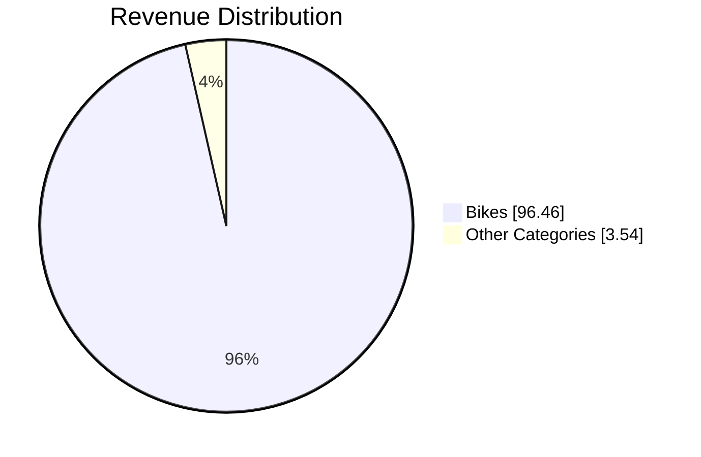
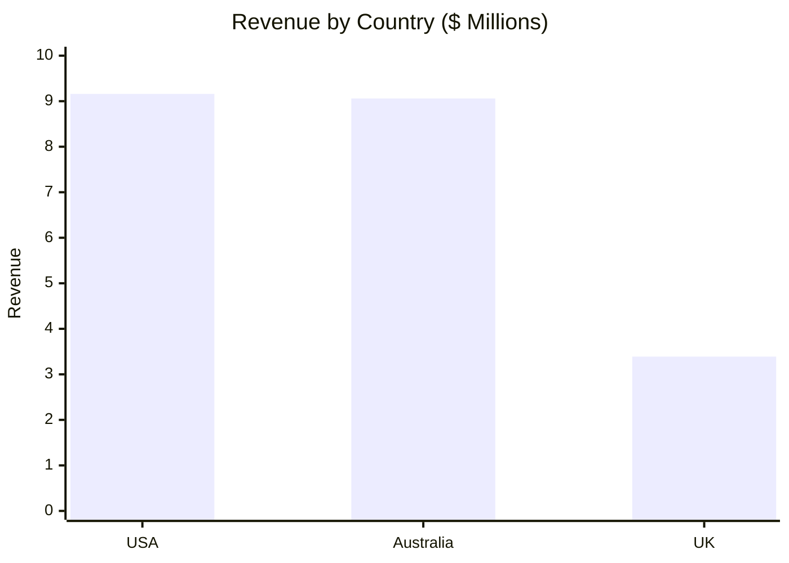

<div align="center">

# 📊 SQL Exploratory Data Analysis | Sales Performance

### Turning 60K+ Sales Records into Actionable Business Insights Using MySQL


**An end-to-end SQL project focused on exploring sales data, identifying business trends, measuring performance, and discovering actionable insights.**

</div>

---

## 🚀 Project Overview

What drives revenue? Which products generate the highest sales? Which customers contribute the most? And where are the biggest business opportunities?

In this project, I performed Exploratory Data Analysis (EDA) using **MySQL** to answer these questions.

Working with a sales database containing more than 60K records, I explored customer behaviour, product performance, revenue distribution, geographical trends, and data quality.

The objective was not just to write SQL queries, but to transform raw data into meaningful business insights that can support better decision-making.

## 📊 Project Highlights

| KPI | Business Result |
|---|---:|
| 💰 Total Revenue | **$29.36M** |
| 📦 Total Quantity Sold | **60,423** |
| 🛒 Unique Orders | **27,659** |
| 👥 Total Customers | **18,484** |
| 🏷️ Total Products | **295** |
| 📈 Sales Records | **60,398** |

## 💡 Key Business Insights

### 1. Bikes Dominate Revenue

- Bikes generated approximately **$28.32M** in revenue.
- They contribute approximately **96.46% of total revenue**.
- Only 97 bike products account for the majority of business revenue.

**Business Impact:** The company should closely monitor bike inventory, pricing, and product availability because this category is the primary revenue driver.

### 2. Top 5 Products Generate Significant Revenue

- The top 5 products generated approximately **$6.67M**.
- These products belong to the Mountain-200 product line.

**Business Impact:** Identifying high-revenue products can help prioritize inventory planning and product marketing.

### 3. United States and Australia Lead Sales

| Country | Revenue |
|---|---:|
| United States | ~$9.16M |
| Australia | ~$9.06M |
| United Kingdom | ~$3.39M |

**Business Impact:** These markets represent important opportunities for targeted marketing and regional sales strategies.

### 4. High Sales Volume Does Not Always Mean High Revenue

Accessories such as water bottles, tire tubes, and patch kits generate high sales quantities, while premium bikes contribute significantly more revenue.

**Business Impact:** Businesses should evaluate both quantity sold and revenue generated instead of relying on sales volume alone.

### 5. Customer Retention Opportunity

- 18,484 customers placed orders.
- 11,619 customers placed exactly one order.

**Business Impact:** Customer retention campaigns, loyalty programs, and repeat-purchase strategies could be explored to improve customer lifetime value.

---

## 📈 Visual Business Insights

### Revenue Contribution by Category



### Sales Performance by Country



---

## 🔍 Analysis Performed

This project covers multiple dimensions of exploratory analysis.

| Analysis Area | What I Investigated |
|---|---|
| Database Exploration | Tables, columns, schema and metadata |
| Data Quality | NULL values, duplicates and unmatched keys |
| Measures Exploration | Revenue, quantity, orders and average price |
| Magnitude Analysis | Performance by country, category and customer |
| Ranking Analysis | Top-performing products and customers |
| Time Analysis | Sales dates and historical trends |
| Customer Analysis | Customer distribution and purchasing behaviour |
| Product Analysis | Revenue and quantity by product |

## 🛠️ Technical Skills Demonstrated

- MySQL
- SQL Joins
- Aggregate Functions
- Common Table Expressions (CTEs)
- Subqueries
- UNION ALL
- Window Functions
- ROW_NUMBER()
- RANK()
- DENSE_RANK()
- PARTITION BY
- GROUP BY and ORDER BY
- CASE WHEN
- Data Quality Checks
- Business KPI Analysis

### Example: Product Revenue Ranking Using Window Functions

```sql
SELECT
    p.product_name,
    SUM(f.sales_amount) AS total_revenue,

    ROW_NUMBER() OVER (
        ORDER BY SUM(f.sales_amount) DESC
    ) AS row_num,

    RANK() OVER (
        ORDER BY SUM(f.sales_amount) DESC
    ) AS product_rank,

    DENSE_RANK() OVER (
        ORDER BY SUM(f.sales_amount) DESC
    ) AS dense_rank

FROM gold.fact_sales f

LEFT JOIN gold.dim_products p
    ON f.product_key = p.product_key

GROUP BY p.product_name
ORDER BY total_revenue DESC;
```

This query demonstrates how SQL window functions can rank products based on revenue and help identify top-performing products.

## 🗃️ Dataset Overview

The project uses three tables from the Gold Layer:

| Table | Records | Description |
|---|---:|---|
| gold.fact_sales | 60,398 | Sales transactions |
| gold.dim_customers | 18,484 | Customer information |
| gold.dim_products | 295 | Product information |

### Data Quality Findings

| Validation | Result |
|---|---:|
| Duplicate Customer Keys | 0 |
| Duplicate Product Keys | 0 |
| Unmatched Foreign Keys | 0 |
| Missing Customer Country | 337 |
| Missing Customer Gender | 15 |
| Missing Product Category | 7 |
| Missing Order Dates | 19 |

These checks help identify potential reporting limitations and improve confidence in analytical results.

## 📂 Repository Structure

```text
EDA_SQL/
│
├── SQL_EDA.sql
├── gold.dim_customers.csv
├── gold.dim_products.csv
├── gold.fact_sales.csv
└── README.md
```

## ⚙️ How to Run This Project

1. Clone this repository.
2. Import the CSV datasets into MySQL.
3. Create and populate the required Gold Layer tables.
4. Open `SQL_EDA.sql` in MySQL Workbench.
5. Execute the queries to explore the analysis.

**Main SQL File:** [SQL_EDA.sql](./SQL_EDA.sql)

---

## 💼 Business Recommendations

Based on the analysis:

- **Revenue Optimization:** Focus on the Bikes category, which generates the majority of revenue.
- **Product Strategy:** Prioritize high-revenue products for inventory and marketing decisions.
- **Market Expansion:** Evaluate growth opportunities in the US and Australian markets.
- **Customer Retention:** Investigate strategies to encourage one-time customers to purchase again.
- **Sales Strategy:** Track both sales volume and revenue to understand actual product performance.
- **Data Reliability:** Address missing values before using customer and product attributes in business reporting.

---

## 👩‍💻 About the Analyst

I am passionate about Data Analytics, SQL, and Business Intelligence.

I enjoy exploring complex datasets, solving analytical problems, identifying hidden patterns, and translating data into meaningful business insights.

Through this project, I demonstrate my ability to approach data analytically, use SQL to answer business questions, and communicate findings in a business-oriented way.

**Open to Data Analyst and Business Intelligence opportunities.**

🔗 GitHub: [@analytical-shruti](https://github.com/analytical-shruti)

---

<div align="center">

### ⭐ If you find this project interesting, consider giving it a star!

**Turning Data into Insights. Turning Insights into Decisions.**

</div>
