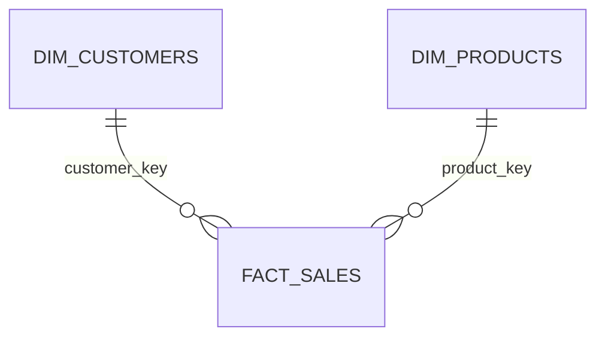
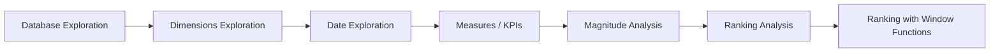

# EDA_SQL
A structured Exploratory Data Analysis in MySQL on a sales data warehouse (gold schema): 60K+ sales rows, 295 products and 18,484 customers. The analysis explores business dimensions, date ranges and transactional metrics, calculates key KPIs, and ranks the best and worst products, subcategories, customers and countries.

# 🔍 SQL Exploratory Data Analysis (EDA)


A structured **Exploratory Data Analysis in MySQL** on a sales data warehouse (`gold` schema): **60K+ sales rows, 295 products and 18,484 customers**. The analysis explores business dimensions, date ranges and transactional metrics, calculates key KPIs, and ranks the best and worst products, subcategories, customers and countries.


---

## 📌 Project Highlights

- Conducted EDA on **60K+ sales records** across **295 products** and **18,484 customers**, examining business dimensions, date ranges and transactional metrics to understand sales patterns.
- Calculated key business KPIs: **total sales of $29.36M**, **60,423 units sold** and **27,659 distinct orders**.
- Ranked top-performing products and customers; the **top 5 products generated a combined $6.67M** (all from the Mountain-200 bike line).

---

## 🗂️ Dataset

| Table | Type | Rows | Description |
|---|---|---|---|
| `gold.fact_sales` | Fact | 60,398 | Order lines: order number, dates, sales amount, quantity, price |
| `gold.dim_customers` | Dimension | 18,484 | Customer details: name, country, gender, birthdate |
| `gold.dim_products` | Dimension | 295 | Product details: category, subcategory, cost |

**Data quality checks:** 0 duplicate customer or product keys and 0 unmatched foreign keys in `fact_sales`. NULLs found: 337 customers without a country, 15 without gender, 7 products without a category, 19 sales rows without an order date.



## 🔄 EDA Workflow



---

## 1️⃣ Database Exploration
Used `INFORMATION_SCHEMA.TABLES` and `INFORMATION_SCHEMA.COLUMNS` to list every table, view and column (with data types and nullability) before writing any analysis.

## 2️⃣ Dimensions Exploration
Identified the customer countries (US, Australia, UK, France, Germany, Canada), product categories (Bikes, Components, Clothing, Accessories) and the full category → subcategory → product hierarchy.

## 3️⃣ Date Exploration
- **Order history:** 2010-12-29 to 2014-01-28 (3+ years, 36 full months)
- **Customer birthdates:** 1916-02-10 (oldest) to 1986-06-25 (youngest)


## 4️⃣ Measures Exploration (KPIs)
A single consolidated KPI report built with `UNION ALL`:

| Measure | Value |
|---|---|
| Total Sales | 29,356,250 |
| Total Quantity | 60,423 |
| Average Price | ~486.04 |
| Order Lines | 60,398 |
| Unique Orders | 27,659 |
| Total Products | 295 |
| Total Customers | 18,484 |
| Customers Who Ordered | 18,484 |

```sql
SELECT 'Total Sales' AS measure_name, SUM(sales_amount) AS measure_value FROM gold.fact_sales
UNION ALL
SELECT 'Unique Orders', COUNT(DISTINCT order_number) FROM gold.fact_sales
UNION ALL
SELECT 'Total Customers', COUNT(customer_key) FROM gold.dim_customers;
-- ... (full query in the .sql file)
```

## 5️⃣ Magnitude Analysis
Measures aggregated by a dimension: customers, products, cost and revenue.


**Insight:** Bikes are only 97 of 295 products but generate **$28.32M of revenue (96.46%)**. The United States and Australia together account for over 60% of sales.

## 6️⃣ Ranking Analysis

### Products


### Subcategories


### Customers


## 7️⃣ Ranking Exploration (Window Functions)

`ROW_NUMBER()`, `RANK()` and `DENSE_RANK()` on product revenue. Ties show the difference between the three functions:


```sql
SELECT p.product_name,
       SUM(f.sales_amount) AS total_revenue,
       ROW_NUMBER() OVER (ORDER BY SUM(f.sales_amount) DESC) AS row_num,
       RANK()       OVER (ORDER BY SUM(f.sales_amount) DESC) AS product_rank,
       DENSE_RANK() OVER (ORDER BY SUM(f.sales_amount) DESC) AS product_dense_rank
FROM gold.fact_sales f
LEFT JOIN gold.dim_products p ON f.product_key = p.product_key
GROUP BY p.product_name
ORDER BY total_revenue DESC;
```

**More rankings:** top and bottom 10 products by quantity, and the top 3 products in every category using `ROW_NUMBER() OVER (PARTITION BY category ...)`.


---

## 💡 Key Insights

- **Bikes dominate revenue:** the top 5 products are all Mountain-200 bikes ($6.67M combined).
- **Low-priced accessories sell in volume:** the water bottle, patch kit and tire tubes lead by units, but contribute little revenue.
- **Two markets lead:** the US ($9.16M) and Australia ($9.06M) are well ahead of the UK ($3.39M).
- **Most customers are one-time buyers:** 11,619 of 18,484 customers placed exactly one order.

## 🛠️ Tech Stack

MySQL 8.0 · CTEs · Window Functions (`ROW_NUMBER`, `RANK`, `DENSE_RANK`) · Joins · Aggregations · `UNION ALL` · `INFORMATION_SCHEMA`

## 📁 Repository Structure

```
SQL-EDA/
├── SQL_EDA.sql          # All EDA queries (Q1 to Q41)
├── dataset/             # gold_dim_customers.csv, gold_dim_products.csv, gold_fact_sales.csv
├── images/              # Charts used in this README
└── README.md
```


## 📬 Contact

**Your Name** · [LinkedIn](https://www.linkedin.com/in/shrutikumbhare12/)
